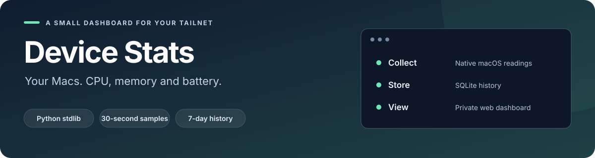
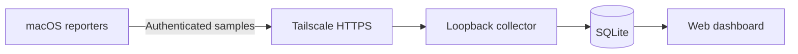

<p align="center"></p>

<p align="center">
  
  
  
</p>

A lightweight dashboard for **CPU, memory, battery and power state across your Macs**. Python reporters send readings every 30 seconds; one collector keeps seven days of SQLite history.



## Set up

Requires macOS, Python 3.9+ and devices already connected to your tailnet. Clone this repo on the host and each reporting Mac; run commands from the checkout.

**1 · Start the dashboard on the host Mac**

```sh
python3 install.py server
tailscale serve --bg --https=8443 http://127.0.0.1:8787
```

**2 · Install a reporter on each Mac**

Use the HTTPS URL printed by Tailscale Serve and a unique device ID:

```sh
python3 install.py client my-mac https://HOST.TAILNET.ts.net:8443
```

**3 · Register that reporter on the host**

Use the fingerprint printed by the client installer:

```sh
python3 install.py register my-mac "My Mac" CLIENT_FINGERPRINT
```

Open the Serve URL from a permitted tailnet device. Dashboard access is controlled by your tailnet; uploads also require a per-device token.

## At a glance

| Readings | History | Installation |
| --- | --- | --- |
| CPU · approximate RAM usage · battery · power state | 1 hour · 24 hours · 7 days, with hover readings | Per-user macOS LaunchAgents |

## Update

```sh
git pull --ff-only
python3 install.py restart
```

The working database, logs and client configuration are ignored by Git. No live device data or tokens are included in this repository.

[Detailed setup & fingerprint recovery](docs/USAGE.md) · [Collector](server/server.py) · [Reporter](client/reporter.py)
